# CORE-INDEX · 《电光年华》开发文档总索引

> **范围**：本文规定作品定位、当前范围、全局不变量 INV-1–INV-12、坐标与数据约定和阅读路径，并给出全部文档的地图、工作包矩阵和依赖图。
> **不在本文**：已定决策的登记（CORE-DECISIONS）；文档编码与写法（CORE-CONVENTIONS §7）；术语（CORE-GLOSSARY）；工作包（ENG-WP）；门禁（ENG-GATES）；扩展路线（ENG-ROADMAP）。
> **查阅**：先读 §0；作品定位看 §1；当前范围与主线看 §2；全局不变量看 §3；坐标与数据看 §4；文档怎么组织看 §5；怎么查文档看 §6；文档地图看 §7；工作包与文档的对应看 §8
> **关联**：[CORE-DECISIONS 决策登记](core/CORE-DECISIONS.md)、[CORE-CONVENTIONS 约定](core/CORE-CONVENTIONS.md)、[CORE-GLOSSARY 术语表](core/CORE-GLOSSARY.md)、[ENG-WP 工作包](engineering/ENG-WP.md)、[ENG-GATES 验收门禁](engineering/ENG-GATES.md)、[ENG-ARCH 工程架构](engineering/ENG-ARCH.md)、[ENG-ROADMAP 扩展路线](engineering/ENG-ROADMAP.md)

## 0 结论

- 《电光年华》（*Electric Years*）是一部校园题材的独立 RPG，第一张地图是电子科技大学清水河校区。当前阶段做它的世界与观光模式，RPG 玩法以后按 ENG-ROADMAP 的扩展点接入（§1、§2）。
- 本目录 `docs/design/` 是唯一的开发依据。每份文档的文件名就是它的编码（例如 SYS-WEATHER），文件头写明主责工作包、依赖和门禁；引用写成"编码 §小节"（CORE-CONVENTIONS §7）。
- 子代理开工只读开工手册 ENG-ONBOARD（经仓库根的 `CLAUDE.md` 自动载入）和自己的派工行，其余文档按需查（§6，D-178）；主代理和新会话从本文读起。§7 的文档地图、§8 的工作包矩阵和 §9 的依赖图都由各文档的文件头生成，全部小节的目录在 `SECTIONS.md`。
- `docs/godot-api/` 是 Godot 4.7.2 C# API 参考，写代码前先查它。文档只记录现行状态，不保留修订记录（D-152）。

### 0.1 接入要点

- **任何包**：遵守 §3 的全局不变量 INV-1–INV-12，它们优先于各文档的细则。
- **主线阶段**：只交主线版，主线的定义见 §2（D-168）。
- **坐标与数据**：按 §4，细则见 CORE-CONVENTIONS §1。
- **找文档**：§7 的文档地图每份一行；全部小节见 `SECTIONS.md`；查法见 ENG-ONBOARD §4。

## 1 作品定位

- **是什么**：《电光年华》首先是一部校园题材的独立 RPG，主线从入学到毕业；第一张地图设在电子科技大学清水河校区，观景是次要的。
  - 当前阶段做的是它在 PC（Windows）上实时渲染的三渲二世界和观光模式。RPG 的世界、渲染、地图服务、存档、音频与观光共用一套，观光是其中一个规则集（ENG-ROADMAP §1）。
  - 风格是浓厚的日式动画背景美术，气质清透干净：整体明度高，线细而随底色，影子浅而透（ART-STYLE）。
  - 观者有两种方式看校园：像《我的世界》的旁观者那样自由飞行、穿墙、钻地；或者切到行走模式，以 1.62 m 的眼高在校园里走、跑、跳（SYS-WALK）。
  - 时刻、季节和天气都可以在界面上调节（SYS-TIME、UI-NAV、SYS-WEATHER）；时间只往前走，不能逆转（SYS-TIME §1）。
- **技术栈**：Godot 4.7.2-stable .NET 版，全部用 C#；渲染器 Forward+，默认 D3D12；着色器用 Godot 着色语言。浏览器方案（three.js、React、Vite）已作废，旧代码只留在 git 标签 `baseline-map` 里（SYS-VIEW §1、ENG-ARCH §1）。不做手机、网页和触屏。
- **不是什么**：**不是地图复刻**。保留清水河校区的大致地形，主要建筑、道路、设施的位置和形状大体对就行，其余可以风格化；原本没有设计感的地方，主动补上设计（MAP-QSH-ADDITIONS）。
  - **环境不照着照片复刻**：照片和 OSM 只定结构，即楼的体量、层数、平面布局、入口、交通核、道路和水体。材质、色彩、陈设、装饰、标识、生活痕迹按氛围做艺术化处理。
  - **可以增删元素**：可以新增校园里没有、但能加强氛围的元素；也可以删掉现实里有、放进画面难看的元素，例如杂乱的管线、临时围挡、刺眼的广告、施工网架、过多的指示牌。增删都写进覆盖层并写明理由（INV-9）。
  - **日式氛围**：画面走日式动画背景，地图设计理念与之一致：在地图结构不变的前提下，增补和改造的建筑与环境细节带日式日常街景的氛围，主轴保持成电身份（ART-AMBIENCE、INV-7）。
  - **老旧外观一律翻新**：现实中老旧、破损的外观全部换成与新楼同标准的设计，全校建筑立面和地面都不做旧（ART-RENOVATION、MAP-QSH-RENOVATION、D-173、D-174）。
- **视觉优先**：四季、昼夜、天象、花期、天气一律以画面好看为最高优先级。真实数据只作参考和灵感，以及用来保住"认得出是成电"的身份特征。
- **视觉精度分两层：处处不粗糙，近看处更精细**（ART-FIDELITY §0，D-009、D-176）：
  - **底线**：不论镜头在哪里、离得多近，包括 1.7 m 人眼高度、贴墙 0.5 m，以及只有飞行才到的屋顶、高处和背面，看到的东西都不能粗糙：比例对，有倒角和收边，不能露出光秃的拉伸体块或糊掉的贴图。
  - **细节密度**：按精度区 K1–K5 分级，越常被近看的地方细节越多。主轴与地标、行走走廊和开放室内按贴脸标准做满；普通立面保证中景层次；屋顶、背立面和只有飞行才到的位置适度简化，只要求底线和轮廓。
  - 校外的外围街区按"最近可达距离"判定精度（WLD-OUTSKIRTS §4.1）。关着的楼从窗外看、旁观穿墙进去看，用的是窗卡和简化室内；走进开放的室内才是全精度（WLD-INTERIORS §5）。
  - 这是最终验收标准，在集中测试和收尾时全面验收；主线阶段先求完整（§2）。底线不拿来换性能预算，细节密度在预算里按区取舍（INV-12）。
  - 校外的外围街区按"最近可达距离"判定精度（WLD-OUTSKIRTS §4.1）。
  - 关着的楼从窗外看、旁观穿墙进去看，用的是窗卡和简化室内，精度不重要；走进开放的室内才要求全精度（WLD-INTERIORS §5）。
- **叙事与默认状态**：
  - **开场**：作品打开时先是扉页和开始页，背景是最近一个存档的世界（SYS-TITLE §2）。
  - **新游戏**：一律从"落金初灯"开始（SYS-SAVE §5.5）。先播约 44 s 的进场过场，从秋 17:05 以 60× 正向推到 17:30；在 P00 全景上出标题卡，然后交还控制（SYS-TITLE §3）。
  - **默认状态"落金初灯"**：秋季、17:30、晴，日落前约半小时，时间从这一刻起以 1× 自然流逝。落日的金光斜铺过整座校园，八角图书馆刚亮灯，满月从东边升起；耳边是麻雀归巢、阵风里的秋叶声、西湖喷泉的细水声和远处的城市（SYS-AUDIO §4.8）。
  - **继续**：回到上次离开时的样子（SYS-TITLE §4.1、SYS-SAVE §5）。
  - **调节**：观者可以把时间往前拨到一天中的任何时刻，把季节换成春夏秋冬，切换天气；界面上一键就能回到默认状态（SYS-WEATHER §6.6）。
- **画面的变化来自时间、季节、天气的组合**。
  - 落日的金光（"落金"指落日的金色光，不是银杏叶）、刚亮起的第一批灯、八角穹顶、西湖、满月、宣邦楼钟面指针走过的那一刻，都是这些组合里效果好的画面，是默认画面里的几个看点，要保留并做好。但它们不是全片的统领原则。
  - 每季手调的英雄帧只是验收样张（SYS-TIME §3.5）。
- **银杏不是画面的主题**：
  - 银杏只作为真实植被，出现在真实种植的地方（WLD-VEGETATION §2 的树种表和 OSM）。
  - 秋季画面的金色主要来自落日的主光，再加上各种秋色树。
  - 界面、图标、锚点里一律不用银杏（UI-VISUAL、SYS-ATLAS）；图书馆红桌上的书签只是普通的生活痕迹（MAP-QSH-LIBRARY §5.1）。

## 2 当前范围

当前阶段做世界与观光模式，包括：

- **观察与世界状态**：两种观察模式、时间与季节、天气、画面设置（SYS-VIEW、SYS-WALK、SYS-TIME、SYS-WEATHER、SYS-GRAPHICS）。
- **界面**：界面内容与组件见 UI-NAV，视觉语言见 UI-VISUAL。
- **开始页与进场过场**：SYS-TITLE。
- **存档与持久化**（SYS-SAVE）：3 个存档位，各自持续自动保存，退出时也自动保存；再进同一存档时，状态与离开时一致。
- **平面地图与传送**（SYS-ATLAS）：左上角常驻小地图，按 M 展开大地图；可以从锚点、观景点、开着的楼门口和路线起点直接传送，也可以飞过去。
- **精选开放的室内**（WLD-INTERIORS）：
  - 第一批 15 处，再加 3 处屋顶或高处；开放的门默认敞开。
  - 其余楼门关着，只做外壳加窗卡。
  - 架构支持以后把任何一栋楼加进来（WLD-INTERIORS §14）。
- **外围的大箱庭**：校界外一圈街区，能看不能进（WLD-OUTSKIRTS）。
- **声音**（SYS-AUDIO）：环境声、观者的动作音、空间声学、界面音效。只在开始页和进场过场放一段原创音乐，做好之前不放。
- **多地图架构**（SYS-MAPS）：可扩展到多张图，当前只做清水河一张（`MapId("qingshuihe")`）。按图的数据放在 `game/data/maps/qingshuihe/`。

**主线与开发顺序**（D-168）：

- **主线**是玩家从启动到离开走得通的一条完整体验：扉页与开始页 → 新游戏（含进场过场）或继续 → 在全校旁观飞行和行走 → 切换时间、季节、天气 → 小地图、大地图与传送 → 存档、退出、再继续。全校的地形、道路、水体和楼宇体量先成形，主要地标认得出。
- **主线优先**：每个工作包先交"主线版"，即能接进主线、跑得通、不崩、不挡路的版本：几何可以简化，参数用默认值，素材可以占位，但接口和数据格式按契约做全。全部系统接通、主线闸口通过之后，再按各文档的完整规格做细节（ENG-WP §1、CORE-CONVENTIONS §8.6）。
- **主线阶段的验收**：§3 里关于内容的规则一直有效（例如不出现人物、时间不逆转、没有日本的宗教与地标符号和日文文字）。风格细节（INV-5）、视觉精度（INV-11）和性能预算（INV-12）是最终验收标准：主线阶段只要求风格方向对、没有明显卡顿，集中测试和收尾时才全面验收。

当前阶段不做游戏玩法和角色。规则集、存档格式、地图服务和解锁策略都已给 RPG 留了接口，v1 冻结前必须加的预留见 ENG-ROADMAP §6。

## 3 全局不变量

下列约束对所有工作包生效，是观光规则集 `sightseeing` 的硬约束。RPG 规则集以后放宽哪些、怎样放宽，由 ENG-ROADMAP §3 登记；在那之前一条不放松。INV 与 ENG-GATES 的门禁 G1–G21 是两套编号：门禁写 G，不变量写 INV。INV-5、INV-11、INV-12 是最终验收标准，主线阶段按 §2 的"主线阶段的验收"执行。

| 编号 | 约束 | 详见 |
| --- | --- | --- |
| INV-1 | 当前阶段是 PC 上实时渲染的观光作品（Godot 4.7.2 .NET，Windows）。不做网页版那套地图功能（搜索、地点卡片、路径规划、在 3D 里拾取）；允许界面里的平面地图（SYS-ATLAS） | SYS-VIEW、ENG-ARCH、SYS-ATLAS |
| INV-2 | 两种观察模式，用 F 键、界面或双击空格切换。**旁观**（默认）：WASD 移动，空格上升，Shift 下降，鼠标转视角，滚轮调速，穿透一切物体。**行走**：有重力和碰撞，操作与《我的世界》一致（行走、疾跑、跳跃、潜行）。不实现环绕、俯视、导览、自动运镜；用户主动触发的点位跳转、传送（SYS-ATLAS）和模式切换过渡不算自动运镜。开始页与进场过场是例外：由观者在开始页主动触发，可以跳过（按住 Esc 0.8 s，跳过后的终态与完整播放一致），路径来自数据文件，交还控制后镜头不再自己动；开始页的 T0 是静止机位（SYS-TITLE） | SYS-VIEW §2、UI-NAV §7、SYS-WALK、SYS-ATLAS、SYS-TITLE |
| INV-3 | 允许的界面以 UI-NAV 和 UI-VISUAL 登记的为准：时间（时间环）、季节、天气（天气格与一行预报，SYS-WEATHER §1）、速度、观察模式、小地图与大地图（含目录页与传送卡，SYS-ATLAS）、扉页（含首次运行的进度行）、开始页与存档页（SYS-TITLE、SYS-SAVE）、过场的放映层与字幕（SYS-TITLE）、操作说明与设置，以及几秒内淡出的临时提示。界面的视觉是信息与光：主色清蓝 #73C9F9，光只表示状态（UI-VISUAL）。漫游态唯一常驻的元素是小地图，可以关；按 U 全部隐藏，`--ui=0` 只留署名。3D 画面里不叠加地点标签、选中描边、世界空间标记或光柱，追踪和传送也一样。界面音效按 SYS-AUDIO §11 登记，悬停默认无声，不加任何语音提示。OSM 署名常驻 | UI-NAV、UI-VISUAL、SYS-ATLAS、SYS-TITLE、SYS-AUDIO §11、SYS-VIEW §6 |
| INV-4 | 场景里本来就有的字要保留，例如楼名题字、店招、路牌，一律用简体中文。校徽、红十字这类受专门规定保护的标志不原样使用，换成风格相近的原创图形（D-065） | ART-STYLE §11 |
| INV-5 | 三渲二日式动画背景，清透干净：分阶明暗（建筑两阶，曲面道具与软物两阶半，植被三阶）；影子以明度为主、按材质推导，浅而透，不一律染蓝紫，不加接触暗影，透光的元素按逆光透射（ART-STYLE §2、ART-STYLE §3）；约 1.25 px（1080p）、随底色染色的细描线（ART-STYLE §4）；平涂贴图，斑驳只留在近处（ART-STYLE §6）；柔光在白天只让高光晕开，黄昏以后才叠全帧柔光（ART-STYLE §7）。画面设置有四档预设（流畅、均衡、精致、极致）加单项，风格底线不可关，实时阴影和西湖倒影只能降质量（SYS-GRAPHICS §2） | ART-STYLE、SYS-GRAPHICS |
| INV-6 | 不出现任何人物或角色，也不加学生剪影；人只以生活痕迹的形式出现。校史馆、博物馆的展陈里也不出现人物肖像，换成实物、文献、模型、风景照（WLD-INTERIORS §11）。声音里没有听得清的人声：人只以远处、听不清、来自看不见的地方的声音出现（SYS-AUDIO §8）。行走模式下观者没有身体和影子，不留脚印 | WLD-LIFE、MAP-QSH-ADDITIONS、SYS-WALK §1、WLD-INTERIORS §11、SYS-AUDIO §8 |
| INV-7 | 日本元素只放开日常街景物件（例如成组售货机、背街的电线杆与架空线、自行车棚），分区与数量按 ART-AMBIENCE，室内同样适用（WLD-INTERIORS §8.5）；日式物件不替代中国校园的识别要素，主轴保持成电身份。日本的宗教符号、地标符号、日文文字和传统和式建筑构件不出现，场景里的字按 INV-4 一律用简体中文。声音允许黄昏远处的乌鸦叫和傍晚广播里的一段原创旋律；宣邦楼钟楼只敲单音铜钟（SYS-AUDIO §6.2、SYS-AUDIO §6.3） | ART-AMBIENCE、ART-STYLE §9、WLD-INTERIORS §8.5、SYS-AUDIO |
| INV-8 | 世界状态有三个量：时刻 0–24 小时连续可调；季节四档可调；天气 8 格加自动（SYS-WEATHER §1）。世界时间在一个世界实例内单调向前，不能逆转：拨时间环只能顺时针，跳到下一次出现的那个钟点（SYS-TIME §1）。新游戏、读档都是换一个世界实例（`IWorldState.Instance` 加 1），不算时间倒流；开始页停着的时间、关着游戏的那段现实时间都不计入世界时间（SYS-TITLE §6、SYS-SAVE §6）。默认状态是新游戏的终态，也是新存档的初值：秋季 17:30、晴、自动天气、流逝 1×；新游戏过场从 17:05 正向推到这里（SYS-TITLE §6）。退出时自动保存，再进同一存档时，世界是退出时的落定状态（SYS-SAVE §5）。流逝模式有暂停、1×、10×、60×、360×、1440×。天气受季节约束：春夏秋降雨、冬季降雪，雷雨只在春夏；自动天气是只走验证过组合的前向随机过程（SYS-WEATHER §6），每个存档一个天气种子（SYS-SAVE）。换季一律正向转场。所有切换都自然过渡，不能硬切；每一种时刻 × 季节 × 天气的组合都要好看 | SYS-TIME、SYS-WEATHER、SYS-TITLE、SYS-SAVE |
| INV-9 | 保留大体地形。照片和 OSM 只定结构，细节按氛围处理（§1）。对 OSM 数据的任何风格化改动、设计增补（`add`）和删除（`hide`），都只能写在覆盖层里，并写明理由；覆盖层按图存放在 `game/data/maps/<地图>/overlay/`（SYS-MAPS §2.1） | MAP-QSH-ADDITIONS、ENG-ARCH §3、SYS-MAPS |
| INV-10 | 所有动态都轻、慢、持续，全片只有一个偶发事件。用户触发的时间、季节、天气、跳转、传送过渡不算偶发事件，进场过场和返回标题也不算；过场期间不触发偶发事件（SYS-TITLE §7.2）。闪电（只做远处云内闪）是雷雨的持续氛围，彩虹是雨后初晴的天象状态，两者都不算偶发事件（SYS-WEATHER §5）。声音同样轻、慢、持续：一次性声按真实秒排程，任何流逝倍率下任意 1 s 不超过 3 个（SYS-AUDIO §7）；偶发事件本身无声，只有它引起的抖落、积雨、旗动有声；远雷是雷雨的持续氛围，跟云内闪同步，可以关（SYS-AUDIO §6） | SYS-MOTION、SYS-TIME §7、SYS-WEATHER §5、SYS-TITLE、SYS-AUDIO |
| INV-11 | 看得见的东西在任何位置、任何距离都满足视觉精度的底线：比例对，有厚度、倒角和收边，没有光秃的拉伸体块，不穿帮、不跳变，包括只有旁观飞行才到的地方。细节密度按精度区 K1–K5 分级、越常被近看越密：主轴与地标、行走走廊和开放室内按贴脸标准，普通立面按中景标准，屋顶、背立面和只有飞行才到的位置只判底线和轮廓。校外的外围街区按"最近可达距离"判定精度（WLD-OUTSKIRTS §4.1）；关着的楼只做外壳、窗卡和简化室内，开放的室内才要求全精度（WLD-INTERIORS §5） | ART-FIDELITY、WLD-OUTSKIRTS、WLD-INTERIORS |
| INV-12 | 满足性能预算与硬规则，包括：界面（主线程、画布渲染 CPU、大页磨砂的 GPU，UI-VISUAL §12）；行走碰撞；存档（快照主线程 p99 ≤ 0.3 ms，从关闭请求到进程结束 ≤ 1.5 s，SYS-SAVE §13）；音频（主线程平均 ≤ 0.35 ms，在播 3D 声源 ≤ 32，常驻 ≤ 96 MB，SYS-AUDIO §18）。安装目录上限 0.9 GB、分发压缩包上限 0.7 GB，几何类烘焙产物在玩家机器上本机烘焙，不计入安装包（D-165，ENG-GATES §2 的 G6） | ENG-BUDGET、ENG-PERF、UI-NAV §9、SYS-WALK §14、UI-VISUAL §12、SYS-SAVE §13、SYS-AUDIO §18 |

## 4 坐标与数据约定

- **坐标系**：单位米，x 向东，y 向上，z 向南。
  - 每张图一个原点和投影，写在该图 `campus.json` 的 `meta` 里，`map.json` 不重复（SYS-MAPS §3）。清水河的原点在经度 103.9282919、纬度 30.75316145，投影为 EPSG:32648。
  - 地图之间的坐标互不相通，跨图引用写成"地图 + ID"；单图半径不超过 8 km（SYS-MAPS §12）。
  - 与 Godot 一致：Godot 也是右手系、y 向上，相机默认朝 −z 看。所以数据坐标直接当 Godot 世界坐标用，正北就是 Godot 的前方（−z），偏航 0° 的相机朝北。
- **清水河的几个范围**：
  - 校界外接框约为 x −991…989、z −1020…1021；
  - 箱庭（含外围街区）约为 x −1250…1260、z −1400…1440，以 `map.json` 的地图包围盒为准；
  - 全图数据纹理的覆盖范围 `map_rect` 取 x、z 都是 −1280…1280（SYS-MAPS §10、WLD-OUTSKIRTS §3.5）。
- **方位角**：一律用罗盘方位，从正北开始顺时针计。方位 A 对应的水平单位向量是 (x, z) = (sin A, −cos A)。
  - 在 Godot 里，罗盘方位 A 对应节点的 `Rotation.Y = −A`（弧度）：Godot 绕 y 轴的正向旋转是从上往下看逆时针，与罗盘方向相反。偏航、日月方位、点位朝向一律按这条换算。
- **实体 ID**：各区文件里的"实体 ID"就是 `game/data/maps/qingshuihe/campus.json` 中 `entities[].id` 的值，用它定位对象，不靠名字。
  - 实体 ID 只在本图内唯一。清水河数据的前缀 `qsh:` 是 OSM 管线的既有写法，属于数据，不是地图 ID；地图 ID 一律写 `qingshuihe`（SYS-MAPS §2.1）。
  - OSM 把东湖畔的雕像误标为"孙立人像"（`qsh:node:7867995301`），按吴立人像处理。
- **新增内容**：所有新增的设计物体都写进覆盖层，ID 以 `design:` 开头（ENG-ARCH §3）。增补（`add`）和删除（`hide`）都写明理由（INV-9）。
- 其余单位、时间写法、编号与命名的速查见 CORE-CONVENTIONS §1–§3。

## 5 文档怎么组织

- **编码**：规范文档的文件名就是编码，写成 `<领域>-<主题>`，例如 `SYS-WEATHER`；地图文档再带图名，例如 `MAP-QSH-CORE`。开发中临时产生的提案、问题、实验和重大决策另成记录类文档，编码为 `RFC-`、`ISS-`、`EXP-`、`ADR-` 加领域加短名，放在各自的文件夹里（§7.9）。
- **小节与引用**：小节在本文内编号，跨文档写"SYS-WEATHER §6.4"，同一文档内只写"§6.4"；不变量写"INV-6"，决策写"D-133"。
- **文件头**：每份文档以 YAML 文件头开头，写编码、类别、一句话摘要、主责工作包、有增量的工作包、依赖、相关、契约、数据和门禁。§7–§9 由 `scripts/docs/gen_index.py` 从这些字段生成；`scripts/docs/check_docs.py` 校验引用、文件头和链接。
- **只写现行规则**：不写修订记录、用户原话和调研证据。
- **新增文档**：放进对应文件夹，写文件头和范围块，再在 §7 登记一行。细则见 CORE-CONVENTIONS §7.7。
- **冲突**：按 CORE-CONVENTIONS §7.6 的层级判定。REF-PROMPT 是作品描述的备份，与拆分文档冲突时以拆分文档为准（D-153）。
- **便于查阅**：每份规范文档带 `keywords`、范围块的"查阅"行、§0 结论和 §0 末尾的"接入要点"；小节目录 `docs/design/SECTIONS.md` 列出全部小节的行号与字数，由 `scripts/docs/gen_index.py` 生成（CORE-CONVENTIONS §7.2，D-178）。

## 6 阅读路径

文档按需查，不要求开工前通读（D-178）。

1. **子代理**：开工只读开工手册 ENG-ONBOARD（仓库根的 `CLAUDE.md` 会自动引入它）、ENG-WP §2 与 ENG-WP §2.1 里本包的两行，以及派工简报。其余按 ENG-ONBOARD §4 查：
   - 先在小节目录 `docs/design/SECTIONS.md` 里按关键词或编码定位，再只读需要的小节；
   - 碰到别的系统，先看那份文档 §0 末尾的"接入要点"；按要做的事查哪里，见 ENG-ONBOARD §4.2。
2. **写 Godot 代码的包**：以 [../godot-api/](../godot-api/README.md) 里的签名为准，不凭记忆写 API（D-145）。模型记忆里混着 Godot 3 和 4 的旧写法，这是最常见的错误来源。
3. **按包类型的常用起点**（需要时查，不是通读清单）：
   - 区域包与部件包：MAP-QSH-ADDITIONS §7 的分工表和本区的 MAP-QSH 文档；碰撞体与可行走数据 SYS-WALK §6–§8、SYS-WALK §13；碰撞体的 `Foot` 材质与有声部件的 `Sounds()` 插座 SYS-AUDIO §9.3、SYS-AUDIO §4.2。
   - 有开放室内的包（WP-17、WP-31a–c）和区域包：WLD-INTERIORS §0、§4、§10、§14。
   - 外围包（WP-47）和与校界有关的包（WP-06、WP-22、WP-30、WP-42、WP-44）：WLD-OUTSKIRTS §0。
   - 有存档段的包：SYS-SAVE §2、SYS-SAVE §10。
   - §8 的矩阵列出每个包是哪些文档的主责、在哪些文档里有增量。
4. **主代理与改文档的人**：先读本文和 ENG-STATUS；改文档按 CORE-CONVENTIONS §7–§8、ENG-WP §5、CORE-DECISIONS §0。
5. **准备做 RPG 时**：ENG-ROADMAP 全文、ENG-ARCH 末尾的"扩展点（RPG）"一节、SYS-SAVE §10、SYS-ATLAS §11。

## 7 文档地图

### 7.1 共识层 `core/`

| 文档 | 规定什么 | 主责 | 门禁 |
| --- | --- | --- | --- |
| [CORE-CONVENTIONS](core/CORE-CONVENTIONS.md) 约定 | 跨文档共同约定速查：坐标单位、时间、编号命名、帧顺序、目录归属、确定性、文档写法与施工规则 | WP-00 | G1、G2、G3、G4、G5 |
| [CORE-DECISIONS](core/CORE-DECISIONS.md) 决策登记 | 全项目已定决策的登记：每条一句结论，附适用范围、细则所在和状态 | — | — |
| [CORE-GLOSSARY](core/CORE-GLOSSARY.md) 术语表 | 文档里专有说法的统一解释，按领域分组，每条一两句并给出细则所在的小节 | — | — |

### 7.2 美术方向 `art/`

| 文档 | 规定什么 | 主责 | 门禁 |
| --- | --- | --- | --- |
| [ART-AMBIENCE](art/ART-AMBIENCE.md) 日式日常街景：元素、分区与做法 | 日式日常街景元素的边界与分区，各元素的形、色、限定与三渲二做法，以及对应的鸟与声音 | WP-13 | G5、G7、G9、G12 |
| [ART-FIDELITY](art/ART-FIDELITY.md) 视觉精度标准：处处不粗糙，细节按区分级 | 任何位置都成立的精度底线、五个精度区的细节密度与判定距离、一票否决与验收方法，含行走走廊加密和外围分级精度 | WP-27 | G2、G7、G8、G9、G12、G13、G15、G17、G19 |
| [ART-MODELING](art/ART-MODELING.md) 风格化造型规则：比例、形体、部件与风格一致性 | 建筑、植被、道具与室内的风格化比例和形体，固有色约束，部件库写法，每类对象的最低合格构件与法线规则，以及金样与跨包风格一致性流程 | WP-09 | G2、G4、G5、G7、G12 |
| [ART-RENOVATION](art/ART-RENOVATION.md) 老楼翻新：全部翻新的规则 | 老楼位置、体量与身份特征不动，外观全部换成新楼标准：材质配色、删简留、窗檐楼梯屋顶的改法、成电辨认与验收 | WP-14 | G5、G7、G9、G12 |
| [ART-SKYLIGHT](art/ART-SKYLIGHT.md) 天空、光照与大气 | 世界状态与美术日月、主光与阴影、天光、天空云星月、雾与大气透视、光效清单与冷暖对照 | WP-34、WP-03、WP-40 | G2、G7、G10、G12、G13、G16、G17 |
| [ART-STYLE](art/ART-STYLE.md) 风格基础：三渲二日式动画背景规范 | 全局风格：调色板与色名、明暗分阶与影色、描线、高光与透光、贴图、后期、排除元素与情绪 | WP-04、WP-05 | G4、G5、G6、G7、G12、G13、G16、G17 |

### 7.3 世界内容（通用） `world/`

| 文档 | 规定什么 | 主责 | 门禁 |
| --- | --- | --- | --- |
| [WLD-DIORAMA](world/WLD-DIORAMA.md) 箱庭边界、截面与远景 | 箱庭外缘的地层截面、水柱截面、雾海与清水河银带、360° 远景卡片和雪山，以及它们随时段、季节、天气的变化 | WP-22 | G4、G5、G7、G8、G12、G13、G16 |
| [WLD-INTERIORS](world/WLD-INTERIORS.md) 室内：开放清单、门的区分、加载、生成器与类型库、楼梯与碰撞、预算 | 第一批 15 处开放室内与 3 处高处、门的开关、室内加载、平面生成器与类型库、楼梯碰撞、契约、预算与 G19 | WP-51、WP-52、WP-17、WP-31a、WP-31b、WP-31c | G5、G6、G8、G9、G15、G18、G19 |
| [WLD-LIFE](world/WLD-LIFE.md) 动物、生活痕迹与街道家具 | 全校动物、生活痕迹、停着的车与街道家具的内容，昼夜、四季与天气的显隐，行走碰撞、声音数据与 Godot 实现 | WP-25、WP-13 | G4、G7、G8、G12、G13、G15、G18、G21 |
| [WLD-OUTSKIRTS](world/WLD-OUTSKIRTS.md) 边界与外围：大箱庭、外围环境带、阻挡与提示 | 大箱庭的三条线与截面精度、外围 O0–O3 的内容与精度、行走和旁观在边界的阻挡与提示、外围数据与预算 | WP-47 | G2、G6、G7、G8、G9、G12、G13、G15、G16 |
| [WLD-VEGETATION](world/WLD-VEGETATION.md) 植被：树种与四季、银杏大道与水杉路、草坪与灌木 | 全校树木、灌木、草坪与水生植物的画法、树种四季、种植位置、季相参数、碰撞、声音接口与 Godot 实现 | WP-23 | G2、G4、G5、G7、G8、G10、G12、G13、G15、G16、G17、G21 |
| [WLD-WATER](world/WLD-WATER.md) 水体：动画式水面、西湖、东湖、河渠、喷泉 | 全校水面的动画式画法、倒影与反光带、四季与天气的水面、各湖与河渠、喷泉与池水，以及 Godot 实现 | WP-24 | G4、G7、G8、G10、G12、G13、G16、G17 |

### 7.4 地图：清水河 `maps/qingshuihe/`

| 文档 | 规定什么 | 主责 | 门禁 |
| --- | --- | --- | --- |
| [MAP-QSH-ADDITIONS](maps/qingshuihe/MAP-QSH-ADDITIONS.md) 设计增补：给没有设计感的地方加设计 | 全校无设计感处的增补词汇、楼宇设计规则、禁做清单、各包增补任务，以及夜间灯光总图和雨天增补 | WP-13、WP-14、WP-28、WP-29、WP-30、WP-39 | G5、G7、G9、G12、G15 |
| [MAP-QSH-CENTER-EAST](maps/qingshuihe/MAP-QSH-CENTER-EAST.md) 中部与东区：中部科研区、雕像、品学楼、文科楼群、训练馆、球场、田径场 | 中部科研区与东区各建筑、雕像、球场的外观与身份特征、开放入口门口表现、四季昼夜、天气、行走、碰撞与声音数据 | WP-21 | G4、G5、G7、G8、G9、G10、G12、G15、G19、G21 |
| [MAP-QSH-CORE](maps/qingshuihe/MAP-QSH-CORE.md) 核心区：八角图书馆、时间广场、日晷、博物馆、西湖 | 核心区图书馆、时间广场、日晷、博物馆外观与西湖岸线构筑物，含四季昼夜、天气、行走与声音要点 | WP-16 | G4、G7、G9、G12、G13、G15、G18、G19、G21 |
| [MAP-QSH-LIBRARY](maps/qingshuihe/MAP-QSH-LIBRARY.md) 图书馆与博物馆室内 | 图书馆开放范围的室内、三条看进去的路径、室内光与视觉落点，以及博物馆展厅、行走与声音要点 | WP-17 | G4、G7、G9、G12、G13、G15、G19、G21 |
| [MAP-QSH-NORTH](maps/qingshuihe/MAP-QSH-NORTH.md) 北部生活区：学生活动中心、校医院、商业街、宿舍组团、餐厅 | 北部生活区各建筑的外观与身份特征、开放入口门口表现、四季昼夜、天气、行走挡路、碰撞与声音数据 | WP-20 | G4、G5、G7、G8、G9、G10、G12、G15、G19、G21 |
| [MAP-QSH-RENOVATION](maps/qingshuihe/MAP-QSH-RENOVATION.md) 清水河翻新清单 | 清水河校区要翻新的楼与环境：逐条的实体、优先级、翻新部位和所用规则，以及待核实楼的做法 | WP-14 | G5、G7、G9、G12 |
| [MAP-QSH-SOUTH](maps/qingshuihe/MAP-QSH-SOUTH.md) 南区：南门、主楼、东湖、宣邦楼、立人楼、体育场馆、国际创新中心 | 南区各楼与构筑物的外观、受光与夜景、四季昼夜与天气、行走与开放入口、声音要点 | WP-18 | G4、G5、G7、G9、G12、G13、G15、G19、G21 |
| [MAP-QSH-WEST](maps/qingshuihe/MAP-QSH-WEST.md) 西区与西北区：六号科研楼、校训石、创新中心、经管楼、托幼园、四号/五号科研楼、湿地、西门桥头 | 西区与西北区各楼、石刻、湿地与西门桥头的外观、四季昼夜与天气、行走与开放入口、声音要点 | WP-19 | G4、G5、G7、G9、G12、G15、G19、G21 |

### 7.5 运行时系统 `systems/`

| 文档 | 规定什么 | 主责 | 门禁 |
| --- | --- | --- | --- |
| [SYS-ATLAS](systems/SYS-ATLAS.md) 平面地图与传送：底图、小地图、大地图、标记、锚点、传送与解锁 | 规定平面地图：底图烘焙与上色、小地图、大地图、标记、锚点、雾幕传送、解锁、契约与 G18 验收 | WP-48 | G2、G13、G14、G15、G16、G18 |
| [SYS-AUDIO](systems/SYS-AUDIO.md) 音频：环境声、观者声、空间声学、界面音效与混音 | 声音的总体架构、环境声景、天气与钟声、观者声、空间声学、界面音、素材许可、契约、预算与 G21 门禁 | WP-53 | G2、G4、G5、G6、G13、G14、G21 |
| [SYS-GRAPHICS](systems/SYS-GRAPHICS.md) 画面设置：预设、单项、风格底线、自动推荐与自适应 | 四档画面预设与单项、风格底线、应用流程、首次分档与自动调节、持久化与命令行、契约与验收 | WP-32 | G2、G5、G7、G8、G9、G10、G11、G12、G13、G14、G16、G17 |
| [SYS-MAPS](systems/SYS-MAPS.md) 多地图：按图数据、`IMapService` 与切换 | 按图数据与 map.json、IMapService 先卸后装切图、时间全局天气按图、map_rect、同图重载门禁 | WP-46 | G2、G4、G5、G6、G7、G8、G13、G16 |
| [SYS-MOTION](systems/SYS-MOTION.md) 动态与事件 | 两个时钟与一拍二，风、悬浮物、流体、生命体与微动的节奏，唯一的偶发事件、季节氛围与转场 | WP-26 | G4、G12、G13、G16、G21 |
| [SYS-SAVE](systems/SYS-SAVE.md) 存档与持久化：存档模型、存什么、格式与迁移、保存时机、加载与一致性、安全、契约与验收 | 规定存档位与世界线、存档段、文件格式与迁移、保存时机、读档流程与一致性、设置文件安全与 G20 | WP-50 | G2、G4、G5、G10、G16、G20 |
| [SYS-TIME](systems/SYS-TIME.md) 时间与季节系统：世界状态、美术日月、色彩脚本、过渡 | 世界状态与控制契约、美术日月、色彩脚本、四季内容、时间季节天气的过渡、灯光时刻表与时季验收 | WP-34、WP-37、WP-38、WP-39、WP-41 | G2、G7、G12、G13、G16 |
| [SYS-TITLE](systems/SYS-TITLE.md) 开始页与进入过场：扉页、开始页、新游戏与继续过场、跳过、`IAppFlow` | 规定冷启动扉页、开始页 T0、新游戏与继续过场、跳过、IAppFlow 状态机与过场数据格式 | WP-49、WP-35d | G2、G7、G8、G10、G13、G14、G16 |
| [SYS-VIEW](systems/SYS-VIEW.md) 观察模式、介质与开场 | 观察模式总述与旁观漫游、镜头在楼里地下水下雾海的介质呈现、启动开场与署名、旧网页栈归档 | WP-06、WP-07、WP-01 | G1、G2、G7、G13、G16、G21 |
| [SYS-WALK](systems/SYS-WALK.md) 行走模式：手感、可行走范围、边界、碰撞与角色控制器 | 行走模式的手感、模式切换、可行走范围与边界、开放室内的门与电梯、角色控制器、碰撞数据与验收 | WP-42、WP-43、WP-44 | G4、G8、G15、G16、G19、G21 |
| [SYS-WEATHER](systems/SYS-WEATHER.md) 天气：天气清单、画面规则、前向随机过程、过渡与验收 | 八格天气的画面与声音规则、自动天气的前向随机过程、各系统的实现、状态与契约、存档段与验收 | WP-45 | G2、G4、G10、G12、G13、G14、G16、G20、G21 |

### 7.6 界面 `ui/`

| 文档 | 规定什么 | 主责 | 门禁 |
| --- | --- | --- | --- |
| [UI-NAV](ui/UI-NAV.md) 界面、点位跳转与操作说明 | 界面的内容与交互：组件、快捷键、点位清单、跳转与传送过渡、无障碍、实现与性能 | WP-35、WP-36 | G2、G4、G7、G13、G14、G15、G16 |
| [UI-VISUAL](ui/UI-VISUAL.md) 界面视觉语言：令牌、字体、形状、材质、图标、组件、画面布局、动效与实现 | 界面视觉规范：色彩令牌与两套主题、字体、形状材质、图标、组件、布局、动效、Godot 实现与验收 | WP-35 | G4、G5、G14、G16 |

### 7.7 工程 `engineering/`

| 文档 | 规定什么 | 主责 | 门禁 |
| --- | --- | --- | --- |
| [ENG-ARCH](engineering/ENG-ARCH.md) 工程架构：模块边界、接口契约与并行开发流程 | 目录与归属、程序集边界、全部 C# 契约、帧顺序、资源管线、桩与工作树流程 | WP-00 | G1、G2、G3、G4、G5、G6 |
| [ENG-BUDGET](engineering/ENG-BUDGET.md) 性能预算与硬规则 | 预设与设备档的预算、细节级别、各包额度总账（budgets.json）、合入硬规则、测法与工程设置 | WP-00 | G4、G5、G6、G8、G10、G11、G13、G14、G15、G16、G17、G20、G21 |
| [ENG-GATES](engineering/ENG-GATES.md) 验收：门禁、审查视角、近景巡检、回报格式 | 审查视角与命令行参数、合入门禁 G1–G21、一票否决、全局清单和回报格式 | WP-27 | G1、G2、G3、G4、G5、G6、G7、G8、G9、G10、G11、G12、G13、G14、G15、G16、G17、G18、G19、G20、G21 |
| [ENG-ONBOARD](engineering/ENG-ONBOARD.md) 子代理开工手册 | 子代理开工时唯一要通读的文档：开工环境、硬规则、查资料的方法与路由、完成与回报 | WP-00 | — |
| [ENG-PERF](engineering/ENG-PERF.md) 性能工程：高质量实现设计（Godot 4.7.2 .NET） | 性能的实现方法：合批、着色器白名单、全局参数登记、预热、剔除、流式、主线程、内存、阴影后期、自适应与测量 | WP-01、WP-02 | G2、G4、G5、G6、G8、G10、G11、G13、G16、G17、G19、G20、G21 |
| [ENG-ROADMAP](engineering/ENG-ROADMAP.md) 扩展路线：从观光到 RPG | 规定观光版给以后 RPG 留的扩展点、现在不能写死的地方和 v1 冻结前的最小预留 | WP-00 | G4、G5、G20 |
| [ENG-STATUS](engineering/ENG-STATUS.md) 施工状态 | 主代理维护的当前施工状态：main、最近可运行入口和活跃工作包的进度 | WP-00 | — |
| [ENG-TEAM](engineering/ENG-TEAM.md) 双模型协作：Opus 与 Astra 的分工 | Claude Opus 与 GPT-6 Astra 两个主力模型的分工、包的归属、开工分波、交接文件与开子代理的方法 | WP-00 | — |
| [ENG-WP](engineering/ENG-WP.md) 工作包派工单：54 个工作包，可并行 53 个 | 54 个工作包的划分、独占目录、起读文档、交付与额度，各包主线版范围，开发阶段与闸口，子代理简报与主代理职责 | WP-00 | G1、G3、G5 |

### 7.8 参考 `reference/`

| 文档 | 规定什么 | 主责 | 门禁 |
| --- | --- | --- | --- |
| [REF-PROMPT](reference/REF-PROMPT.md) 完整提示词（备份） | 作品《电光年华》的完整描述，用作提示词，供通读全貌；不是施工文档 | — | — |

### 7.9 工具 `tools/`

| 文档 | 规定什么 | 主责 | 门禁 |
| --- | --- | --- | --- |
| [TOOL-PREVIEW](tools/TOOL-PREVIEW.md) 内容预览 | 开发构建里预览与回看内容：按实体定位、保留机位与时季天气、复制机位、重读数据 | WP-01、WP-08 | — |

### 7.10 运维 `ops/`

| 文档 | 规定什么 | 主责 | 门禁 |
| --- | --- | --- | --- |
| [OPS-RELEASE](ops/OPS-RELEASE.md) 发布与交付 | 版本号与构建信息、正式用户目录、导出与发布、安装更新卸载、地图数据包、故障诊断和许可 | WP-00 | G6 |

### 7.11 提案 `proposals/`

| 文档 | 规定什么 | 主责 | 门禁 |
| --- | --- | --- | --- |
| [RFC-ART-JP-AMBIENCE](proposals/RFC-ART-JP-AMBIENCE.md) 日式氛围元素目录 |  | — | — |
| [RFC-ART-JP-CONFLICTS](proposals/RFC-ART-JP-CONFLICTS.md) 日式方向与现行规则的冲突 |  | — | — |
| [RFC-ART-OLD-RENOVATION](proposals/RFC-ART-OLD-RENOVATION.md) 老旧建筑的风格化翻新规则 |  | — | — |
| [RFC-MAP-OLD-BUILDINGS](proposals/RFC-MAP-OLD-BUILDINGS.md) 清水河校区老旧建筑清单 |  | — | — |

### 7.12 待用的文件夹

下列文件夹已建好，目前只有 README（编码规则和文件头模板）。新建文档后，重跑本脚本即可登记进上面的表。

| 文件夹 | 编码 | 放什么 |
| --- | --- | --- |
| [characters/](characters/README.md) | CHAR | 角色与 NPC：造型规范、骨骼与动画、行为与日程、与"观光模式不出现人物"的模式切换。 |
| [content/](content/README.md) | CONT | 内容生产：建模与贴图规范、素材来源与许可、导入设置、命名与目录、资产审核流程。 |
| [decisions/](decisions/README.md) | ADR | 重大决策的详细记录（背景、选项、取舍）。每条在 CORE-DECISIONS 登记一行并指向这里；决策一经采纳，规格文档只写结果。 |
| [experiments/](experiments/README.md) | EXP | 原型与实测报告，主要回答各规格文档"待验证（P0）"一节的问题。结论确定后，把定下的数值写回规格文档。 |
| [gameplay/](gameplay/README.md) | GAME | RPG 玩法规则：交互、任务、背包、成长、经济、日程与日历。观光模式的规则集也在这里登记扩展。 |
| [issues/](issues/README.md) | ISS | 开发中发现的问题：现象、复现、影响范围、处理方式。修复后如果改变了设计，结果写进规格文档。 |
| [localization/](localization/README.md) | L10N | 本地化：文本键、字体与字形、语言切换、翻译流程。 |
| [narrative/](narrative/README.md) | NARR | 剧情、章节、事件脚本、对话与文本规范。 |
| [qa/](qa/README.md) | QA | 测试计划、回归清单、人工评审流程。门禁的权威定义仍在 ENG-GATES。 |

## 8 工作包与文档

主责与增量取自各文档文件头的 `owners`、`contributors`；独占目录、起读与交付以 ENG-WP 为准。

| 工作包 | 主责文档 | 有增量的文档 |
| --- | --- | --- |
| WP-00 | CORE-CONVENTIONS、ENG-ARCH、ENG-BUDGET、ENG-ONBOARD、ENG-ROADMAP、ENG-STATUS、ENG-TEAM、ENG-WP、OPS-RELEASE | ENG-GATES、SYS-AUDIO、SYS-MAPS、SYS-SAVE、SYS-VIEW、SYS-WALK、WLD-INTERIORS |
| WP-01 | ENG-PERF、SYS-VIEW、TOOL-PREVIEW | ENG-ARCH、ENG-GATES、OPS-RELEASE、SYS-ATLAS、SYS-AUDIO、SYS-GRAPHICS、SYS-MAPS、SYS-SAVE、SYS-TITLE、SYS-WALK、SYS-WEATHER、UI-NAV、UI-VISUAL |
| WP-02 | ENG-PERF | ENG-ARCH、ENG-BUDGET、ENG-GATES、OPS-RELEASE、SYS-AUDIO、SYS-GRAPHICS、SYS-MAPS、SYS-SAVE、SYS-TITLE、SYS-WEATHER、TOOL-PREVIEW、WLD-INTERIORS、WLD-OUTSKIRTS、WLD-VEGETATION |
| WP-03 | ART-SKYLIGHT | ENG-PERF、MAP-QSH-LIBRARY、MAP-QSH-NORTH、MAP-QSH-SOUTH、SYS-AUDIO、SYS-GRAPHICS、SYS-SAVE、SYS-TIME、SYS-WEATHER、WLD-INTERIORS |
| WP-04 | ART-STYLE | ART-AMBIENCE、ART-FIDELITY、ART-RENOVATION、ART-SKYLIGHT、ENG-ARCH、ENG-PERF、MAP-QSH-ADDITIONS、MAP-QSH-LIBRARY、MAP-QSH-SOUTH、SYS-ATLAS、SYS-GRAPHICS、SYS-TIME、SYS-VIEW、SYS-WEATHER、UI-VISUAL、WLD-INTERIORS、WLD-OUTSKIRTS |
| WP-05 | ART-STYLE | ART-SKYLIGHT、ENG-PERF、SYS-GRAPHICS、SYS-WEATHER、WLD-OUTSKIRTS |
| WP-06 | SYS-VIEW | ART-SKYLIGHT、ENG-GATES、ENG-ROADMAP、SYS-ATLAS、SYS-AUDIO、SYS-SAVE、SYS-TITLE、SYS-WALK、UI-NAV、WLD-OUTSKIRTS |
| WP-07 | SYS-VIEW | ART-FIDELITY、ART-SKYLIGHT、ENG-PERF、ENG-ROADMAP、SYS-AUDIO、SYS-GRAPHICS、SYS-WALK、WLD-DIORAMA、WLD-INTERIORS、WLD-WATER |
| WP-08 | TOOL-PREVIEW | ENG-ARCH、OPS-RELEASE、SYS-MAPS、SYS-VIEW、WLD-INTERIORS、WLD-OUTSKIRTS、WLD-VEGETATION |
| WP-09 | ART-MODELING | ART-RENOVATION |
| WP-10 | — | ART-FIDELITY、ART-MODELING、SYS-WALK、WLD-INTERIORS |
| WP-11 | — | ART-MODELING、SYS-AUDIO、SYS-WALK、WLD-INTERIORS |
| WP-12 | — | ART-FIDELITY、ART-MODELING、MAP-QSH-ADDITIONS、MAP-QSH-WEST、WLD-INTERIORS、WLD-LIFE |
| WP-13 | ART-AMBIENCE、MAP-QSH-ADDITIONS、WLD-LIFE | ART-MODELING、MAP-QSH-CENTER-EAST、MAP-QSH-CORE、MAP-QSH-NORTH、MAP-QSH-RENOVATION、MAP-QSH-SOUTH、MAP-QSH-WEST、SYS-ATLAS、SYS-AUDIO、SYS-WALK、WLD-INTERIORS、WLD-OUTSKIRTS |
| WP-14 | ART-RENOVATION、MAP-QSH-ADDITIONS、MAP-QSH-RENOVATION | ART-AMBIENCE、ART-FIDELITY、ART-MODELING、WLD-INTERIORS、WLD-OUTSKIRTS |
| WP-15 | — | ART-AMBIENCE、ART-FIDELITY、ART-MODELING、MAP-QSH-ADDITIONS、MAP-QSH-CENTER-EAST、MAP-QSH-CORE、MAP-QSH-NORTH、MAP-QSH-RENOVATION、MAP-QSH-SOUTH、MAP-QSH-WEST、SYS-AUDIO、SYS-MAPS、SYS-WALK、SYS-WEATHER、WLD-OUTSKIRTS、WLD-VEGETATION |
| WP-16 | MAP-QSH-CORE | ART-AMBIENCE、ART-RENOVATION、MAP-QSH-ADDITIONS、MAP-QSH-LIBRARY、MAP-QSH-RENOVATION、MAP-QSH-WEST、SYS-WALK、WLD-INTERIORS |
| WP-17 | MAP-QSH-LIBRARY、WLD-INTERIORS | ART-RENOVATION、MAP-QSH-CORE、SYS-AUDIO、SYS-WALK |
| WP-18 | MAP-QSH-SOUTH | ART-AMBIENCE、ART-RENOVATION、MAP-QSH-ADDITIONS、MAP-QSH-RENOVATION、SYS-WALK、WLD-INTERIORS、WLD-OUTSKIRTS、WLD-WATER |
| WP-19 | MAP-QSH-WEST | ART-AMBIENCE、ART-RENOVATION、MAP-QSH-ADDITIONS、MAP-QSH-RENOVATION、WLD-INTERIORS |
| WP-20 | MAP-QSH-NORTH | ART-AMBIENCE、ART-RENOVATION、MAP-QSH-ADDITIONS、MAP-QSH-RENOVATION、SYS-WALK、WLD-INTERIORS、WLD-LIFE、WLD-VEGETATION |
| WP-21 | MAP-QSH-CENTER-EAST | ART-AMBIENCE、ART-RENOVATION、MAP-QSH-ADDITIONS、MAP-QSH-RENOVATION、WLD-INTERIORS、WLD-WATER |
| WP-22 | WLD-DIORAMA | SYS-MAPS、SYS-TIME、WLD-OUTSKIRTS |
| WP-23 | WLD-VEGETATION | ART-AMBIENCE、ART-FIDELITY、ART-MODELING、ART-STYLE、ENG-PERF、MAP-QSH-ADDITIONS、MAP-QSH-CENTER-EAST、MAP-QSH-CORE、MAP-QSH-NORTH、MAP-QSH-SOUTH、MAP-QSH-WEST、SYS-GRAPHICS、SYS-MAPS、SYS-SAVE、SYS-WALK、SYS-WEATHER、WLD-OUTSKIRTS、WLD-WATER |
| WP-24 | WLD-WATER | ART-FIDELITY、ENG-PERF、MAP-QSH-ADDITIONS、MAP-QSH-CENTER-EAST、MAP-QSH-CORE、MAP-QSH-SOUTH、MAP-QSH-WEST、SYS-AUDIO、SYS-GRAPHICS、SYS-MAPS、SYS-VIEW、SYS-WALK、SYS-WEATHER、WLD-OUTSKIRTS |
| WP-25 | WLD-LIFE | ART-AMBIENCE、MAP-QSH-CENTER-EAST、MAP-QSH-CORE、MAP-QSH-NORTH、MAP-QSH-SOUTH、MAP-QSH-WEST、SYS-AUDIO、SYS-TITLE、SYS-WEATHER、WLD-VEGETATION |
| WP-26 | SYS-MOTION | ENG-ROADMAP、MAP-QSH-ADDITIONS、MAP-QSH-CORE、MAP-QSH-SOUTH、SYS-AUDIO、SYS-MAPS、SYS-SAVE、SYS-TIME、SYS-WEATHER、WLD-INTERIORS、WLD-LIFE、WLD-VEGETATION、WLD-WATER |
| WP-27 | ART-FIDELITY、ENG-GATES | CORE-CONVENTIONS、ENG-ARCH、ENG-BUDGET、ENG-PERF、ENG-ROADMAP、SYS-ATLAS、SYS-AUDIO、SYS-GRAPHICS、SYS-MAPS、SYS-SAVE、SYS-TITLE、SYS-WEATHER、UI-NAV、UI-VISUAL、WLD-INTERIORS、WLD-OUTSKIRTS、WLD-VEGETATION |
| WP-28 | MAP-QSH-ADDITIONS | MAP-QSH-CENTER-EAST、MAP-QSH-SOUTH、MAP-QSH-WEST、SYS-AUDIO、SYS-WALK、WLD-OUTSKIRTS、WLD-WATER |
| WP-29 | MAP-QSH-ADDITIONS | — |
| WP-30 | MAP-QSH-ADDITIONS | MAP-QSH-CENTER-EAST、MAP-QSH-NORTH、MAP-QSH-SOUTH、MAP-QSH-WEST、SYS-AUDIO、SYS-WALK、WLD-DIORAMA、WLD-OUTSKIRTS、WLD-WATER |
| WP-31 | — | SYS-AUDIO |
| WP-31a | WLD-INTERIORS | MAP-QSH-ADDITIONS、MAP-QSH-SOUTH、SYS-WALK |
| WP-31b | WLD-INTERIORS | MAP-QSH-ADDITIONS、MAP-QSH-CENTER-EAST、MAP-QSH-WEST、SYS-WALK |
| WP-31c | WLD-INTERIORS | ART-MODELING、MAP-QSH-ADDITIONS、MAP-QSH-NORTH、SYS-WALK |
| WP-32 | SYS-GRAPHICS | ENG-BUDGET、ENG-GATES、ENG-PERF、SYS-SAVE、SYS-TITLE |
| WP-33 | — | ENG-PERF、WLD-INTERIORS、WLD-OUTSKIRTS |
| WP-34 | ART-SKYLIGHT、SYS-TIME | ENG-PERF、SYS-MAPS、SYS-MOTION、SYS-SAVE、SYS-TITLE、SYS-WEATHER |
| WP-35 | UI-NAV、UI-VISUAL | ENG-GATES、ENG-ROADMAP、OPS-RELEASE、SYS-ATLAS、SYS-AUDIO、SYS-GRAPHICS、SYS-MAPS、SYS-SAVE、SYS-TIME、SYS-VIEW、SYS-WALK、SYS-WEATHER、WLD-INTERIORS、WLD-OUTSKIRTS |
| WP-35d | SYS-TITLE | — |
| WP-36 | UI-NAV | ENG-BUDGET、ENG-GATES、MAP-QSH-CENTER-EAST、MAP-QSH-CORE、MAP-QSH-NORTH、MAP-QSH-SOUTH、MAP-QSH-WEST、SYS-ATLAS、SYS-AUDIO、SYS-MAPS、SYS-SAVE、SYS-VIEW、SYS-WALK、SYS-WEATHER、WLD-INTERIORS、WLD-OUTSKIRTS |
| WP-37 | SYS-TIME | ART-MODELING、ART-SKYLIGHT、ART-STYLE、ENG-PERF、MAP-QSH-ADDITIONS、SYS-WEATHER、UI-VISUAL、WLD-DIORAMA、WLD-INTERIORS、WLD-OUTSKIRTS、WLD-VEGETATION、WLD-WATER |
| WP-38 | SYS-TIME | ENG-PERF、MAP-QSH-ADDITIONS、MAP-QSH-CENTER-EAST、MAP-QSH-CORE、MAP-QSH-NORTH、MAP-QSH-SOUTH、MAP-QSH-WEST、SYS-AUDIO、SYS-GRAPHICS、SYS-MOTION、SYS-WEATHER、WLD-OUTSKIRTS、WLD-VEGETATION |
| WP-39 | MAP-QSH-ADDITIONS、SYS-TIME | ART-SKYLIGHT、ART-STYLE、ENG-PERF、ENG-ROADMAP、MAP-QSH-CENTER-EAST、MAP-QSH-CORE、MAP-QSH-LIBRARY、MAP-QSH-NORTH、MAP-QSH-SOUTH、MAP-QSH-WEST、SYS-ATLAS、SYS-AUDIO、SYS-MAPS、SYS-MOTION、SYS-SAVE、SYS-TITLE、SYS-WEATHER、WLD-INTERIORS、WLD-LIFE、WLD-OUTSKIRTS |
| WP-40 | ART-SKYLIGHT | ENG-PERF、SYS-AUDIO、SYS-MAPS、SYS-MOTION、SYS-TIME、SYS-WEATHER、WLD-DIORAMA |
| WP-41 | SYS-TIME | ENG-GATES、SYS-AUDIO、SYS-GRAPHICS、SYS-TITLE、SYS-WEATHER、WLD-OUTSKIRTS |
| WP-42 | SYS-WALK | ENG-GATES、ENG-PERF、ENG-ROADMAP、SYS-AUDIO、SYS-SAVE、SYS-VIEW、WLD-INTERIORS、WLD-LIFE、WLD-OUTSKIRTS、WLD-WATER |
| WP-43 | SYS-WALK | ENG-GATES、ENG-PERF、MAP-QSH-ADDITIONS、MAP-QSH-CENTER-EAST、MAP-QSH-CORE、MAP-QSH-LIBRARY、MAP-QSH-NORTH、MAP-QSH-SOUTH、MAP-QSH-WEST、SYS-AUDIO、SYS-MAPS、SYS-SAVE、WLD-INTERIORS、WLD-LIFE、WLD-OUTSKIRTS、WLD-VEGETATION |
| WP-44 | SYS-WALK | ART-FIDELITY、ENG-GATES、MAP-QSH-ADDITIONS、MAP-QSH-CENTER-EAST、MAP-QSH-CORE、MAP-QSH-NORTH、MAP-QSH-SOUTH、MAP-QSH-WEST、SYS-ATLAS、SYS-MAPS、WLD-INTERIORS、WLD-OUTSKIRTS、WLD-WATER |
| WP-45 | SYS-WEATHER | ART-SKYLIGHT、ART-STYLE、ENG-GATES、ENG-PERF、MAP-QSH-ADDITIONS、SYS-AUDIO、SYS-GRAPHICS、SYS-MAPS、SYS-MOTION、SYS-TIME、WLD-OUTSKIRTS |
| WP-45a | — | SYS-SAVE、WLD-VEGETATION |
| WP-45b | — | WLD-VEGETATION、WLD-WATER |
| WP-46 | SYS-MAPS | ENG-GATES、ENG-PERF、ENG-ROADMAP、SYS-AUDIO、SYS-MOTION、SYS-SAVE、SYS-TIME、SYS-TITLE、SYS-WEATHER、TOOL-PREVIEW、WLD-OUTSKIRTS |
| WP-47 | WLD-OUTSKIRTS | ART-AMBIENCE、ART-FIDELITY、ENG-BUDGET、ENG-PERF、MAP-QSH-ADDITIONS、MAP-QSH-CENTER-EAST、MAP-QSH-NORTH、MAP-QSH-SOUTH、MAP-QSH-WEST、OPS-RELEASE、SYS-GRAPHICS、SYS-MAPS、SYS-TIME、SYS-WALK、SYS-WEATHER、WLD-DIORAMA、WLD-VEGETATION、WLD-WATER |
| WP-48 | SYS-ATLAS | ENG-GATES、ENG-PERF、MAP-QSH-ADDITIONS、SYS-AUDIO、SYS-MAPS、UI-NAV、UI-VISUAL、WLD-INTERIORS、WLD-OUTSKIRTS |
| WP-48a | — | WLD-LIFE |
| WP-48b | — | ENG-ROADMAP |
| WP-48c | — | ENG-ROADMAP、MAP-QSH-CENTER-EAST、MAP-QSH-CORE、MAP-QSH-NORTH、MAP-QSH-SOUTH、MAP-QSH-WEST、SYS-SAVE、SYS-WALK、WLD-LIFE |
| WP-49 | SYS-TITLE | ENG-GATES、ENG-PERF、SYS-AUDIO、SYS-MAPS、SYS-SAVE、SYS-VIEW、UI-NAV、UI-VISUAL、WLD-OUTSKIRTS |
| WP-49a | — | ENG-ROADMAP |
| WP-49b | — | WLD-LIFE |
| WP-50 | SYS-SAVE | ENG-GATES、ENG-PERF、ENG-ROADMAP、OPS-RELEASE、SYS-MAPS、SYS-TITLE、SYS-WALK、SYS-WEATHER、UI-NAV、UI-VISUAL |
| WP-51 | WLD-INTERIORS | ART-FIDELITY、ART-MODELING、ENG-PERF、MAP-QSH-ADDITIONS、MAP-QSH-CENTER-EAST、MAP-QSH-CORE、MAP-QSH-LIBRARY、MAP-QSH-NORTH、SYS-ATLAS、SYS-AUDIO、SYS-MAPS、SYS-VIEW、SYS-WALK |
| WP-52 | WLD-INTERIORS | ART-FIDELITY、ART-MODELING、MAP-QSH-ADDITIONS、MAP-QSH-LIBRARY、MAP-QSH-NORTH、WLD-LIFE |
| WP-53 | SYS-AUDIO | ART-AMBIENCE、ENG-GATES、ENG-PERF、MAP-QSH-LIBRARY、MAP-QSH-SOUTH、MAP-QSH-WEST、SYS-MAPS、SYS-MOTION、SYS-VIEW、UI-NAV、UI-VISUAL、WLD-INTERIORS、WLD-LIFE、WLD-OUTSKIRTS、WLD-VEGETATION、WLD-WATER |
| WP-53a | — | SYS-ATLAS、SYS-SAVE、SYS-TITLE |
| WP-53b | — | MAP-QSH-CENTER-EAST、MAP-QSH-CORE、MAP-QSH-NORTH、SYS-WEATHER |
| WP-53d | — | SYS-WALK、SYS-WEATHER |

## 9 文档依赖图

箭头从被依赖的文档指向依赖它的文档，取自文件头的 `depends`。所有文档都依赖本文，图中省略。

```mermaid
graph LR
  subgraph g_core[共识层]
    CORE_CONVENTIONS["CORE-CONVENTIONS"]
    CORE_DECISIONS["CORE-DECISIONS"]
    CORE_GLOSSARY["CORE-GLOSSARY"]
  end
  subgraph g_art[美术方向]
    ART_AMBIENCE["ART-AMBIENCE"]
    ART_FIDELITY["ART-FIDELITY"]
    ART_MODELING["ART-MODELING"]
    ART_RENOVATION["ART-RENOVATION"]
    ART_SKYLIGHT["ART-SKYLIGHT"]
    ART_STYLE["ART-STYLE"]
  end
  subgraph g_world[世界内容（通用）]
    WLD_DIORAMA["WLD-DIORAMA"]
    WLD_INTERIORS["WLD-INTERIORS"]
    WLD_LIFE["WLD-LIFE"]
    WLD_OUTSKIRTS["WLD-OUTSKIRTS"]
    WLD_VEGETATION["WLD-VEGETATION"]
    WLD_WATER["WLD-WATER"]
  end
  subgraph g_maps[地图：清水河]
    MAP_QSH_ADDITIONS["MAP-QSH-ADDITIONS"]
    MAP_QSH_CENTER_EAST["MAP-QSH-CENTER-EAST"]
    MAP_QSH_CORE["MAP-QSH-CORE"]
    MAP_QSH_LIBRARY["MAP-QSH-LIBRARY"]
    MAP_QSH_NORTH["MAP-QSH-NORTH"]
    MAP_QSH_RENOVATION["MAP-QSH-RENOVATION"]
    MAP_QSH_SOUTH["MAP-QSH-SOUTH"]
    MAP_QSH_WEST["MAP-QSH-WEST"]
  end
  subgraph g_systems[运行时系统]
    SYS_ATLAS["SYS-ATLAS"]
    SYS_AUDIO["SYS-AUDIO"]
    SYS_GRAPHICS["SYS-GRAPHICS"]
    SYS_MAPS["SYS-MAPS"]
    SYS_MOTION["SYS-MOTION"]
    SYS_SAVE["SYS-SAVE"]
    SYS_TIME["SYS-TIME"]
    SYS_TITLE["SYS-TITLE"]
    SYS_VIEW["SYS-VIEW"]
    SYS_WALK["SYS-WALK"]
    SYS_WEATHER["SYS-WEATHER"]
  end
  subgraph g_ui[界面]
    UI_NAV["UI-NAV"]
    UI_VISUAL["UI-VISUAL"]
  end
  subgraph g_engineering[工程]
    ENG_ARCH["ENG-ARCH"]
    ENG_BUDGET["ENG-BUDGET"]
    ENG_GATES["ENG-GATES"]
    ENG_ONBOARD["ENG-ONBOARD"]
    ENG_PERF["ENG-PERF"]
    ENG_ROADMAP["ENG-ROADMAP"]
    ENG_STATUS["ENG-STATUS"]
    ENG_TEAM["ENG-TEAM"]
    ENG_WP["ENG-WP"]
  end
  subgraph g_reference[参考]
    REF_PROMPT["REF-PROMPT"]
  end
  subgraph g_tools[工具]
    TOOL_PREVIEW["TOOL-PREVIEW"]
  end
  subgraph g_ops[运维]
    OPS_RELEASE["OPS-RELEASE"]
  end
  subgraph g_proposals[提案]
    RFC_ART_JP_AMBIENCE["RFC-ART-JP-AMBIENCE"]
    RFC_ART_JP_CONFLICTS["RFC-ART-JP-CONFLICTS"]
    RFC_ART_OLD_RENOVATION["RFC-ART-OLD-RENOVATION"]
    RFC_MAP_OLD_BUILDINGS["RFC-MAP-OLD-BUILDINGS"]
  end
  ART_STYLE --> ART_AMBIENCE
  ART_MODELING --> ART_AMBIENCE
  ART_FIDELITY --> ART_AMBIENCE
  MAP_QSH_ADDITIONS --> ART_AMBIENCE
  ART_STYLE --> ART_FIDELITY
  ART_MODELING --> ART_FIDELITY
  ENG_BUDGET --> ART_FIDELITY
  SYS_TIME --> ART_FIDELITY
  SYS_WALK --> ART_FIDELITY
  SYS_WEATHER --> ART_FIDELITY
  SYS_GRAPHICS --> ART_FIDELITY
  WLD_OUTSKIRTS --> ART_FIDELITY
  WLD_INTERIORS --> ART_FIDELITY
  ART_STYLE --> ART_MODELING
  ART_FIDELITY --> ART_MODELING
  SYS_TIME --> ART_MODELING
  WLD_INTERIORS --> ART_MODELING
  ART_STYLE --> ART_RENOVATION
  ART_MODELING --> ART_RENOVATION
  ART_FIDELITY --> ART_RENOVATION
  MAP_QSH_ADDITIONS --> ART_RENOVATION
  ART_STYLE --> ART_SKYLIGHT
  ENG_ARCH --> ART_SKYLIGHT
  ENG_PERF --> ART_SKYLIGHT
  SYS_TIME --> ART_SKYLIGHT
  SYS_WEATHER --> ART_SKYLIGHT
  SYS_GRAPHICS --> ART_SKYLIGHT
  ENG_ARCH --> ART_STYLE
  ENG_PERF --> ART_STYLE
  SYS_TIME --> ART_STYLE
  ENG_GATES --> ENG_ARCH
  ENG_WP --> ENG_ARCH
  ENG_PERF --> ENG_ARCH
  ENG_ARCH --> ENG_BUDGET
  ENG_PERF --> ENG_BUDGET
  SYS_TIME --> ENG_BUDGET
  UI_NAV --> ENG_BUDGET
  SYS_WALK --> ENG_BUDGET
  SYS_WEATHER --> ENG_BUDGET
  SYS_GRAPHICS --> ENG_BUDGET
  UI_VISUAL --> ENG_BUDGET
  SYS_ATLAS --> ENG_BUDGET
  SYS_TITLE --> ENG_BUDGET
  SYS_SAVE --> ENG_BUDGET
  SYS_MAPS --> ENG_BUDGET
  WLD_OUTSKIRTS --> ENG_BUDGET
  WLD_INTERIORS --> ENG_BUDGET
  SYS_AUDIO --> ENG_BUDGET
  ART_FIDELITY --> ENG_GATES
  ENG_ARCH --> ENG_GATES
  ENG_BUDGET --> ENG_GATES
  ENG_PERF --> ENG_GATES
  SYS_TIME --> ENG_GATES
  UI_NAV --> ENG_GATES
  SYS_WALK --> ENG_GATES
  SYS_WEATHER --> ENG_GATES
  SYS_GRAPHICS --> ENG_GATES
  UI_VISUAL --> ENG_GATES
  SYS_ATLAS --> ENG_GATES
  SYS_TITLE --> ENG_GATES
  SYS_SAVE --> ENG_GATES
  SYS_MAPS --> ENG_GATES
  WLD_OUTSKIRTS --> ENG_GATES
  WLD_INTERIORS --> ENG_GATES
  SYS_AUDIO --> ENG_GATES
  CORE_CONVENTIONS --> ENG_ONBOARD
  ENG_ARCH --> ENG_ONBOARD
  ENG_WP --> ENG_ONBOARD
  ENG_ARCH --> ENG_PERF
  ENG_BUDGET --> ENG_PERF
  SYS_TIME --> ENG_PERF
  UI_NAV --> ENG_PERF
  SYS_WALK --> ENG_PERF
  SYS_WEATHER --> ENG_PERF
  SYS_GRAPHICS --> ENG_PERF
  UI_VISUAL --> ENG_PERF
  SYS_ATLAS --> ENG_PERF
  SYS_TITLE --> ENG_PERF
  SYS_SAVE --> ENG_PERF
  SYS_MAPS --> ENG_PERF
  WLD_OUTSKIRTS --> ENG_PERF
  WLD_INTERIORS --> ENG_PERF
  SYS_AUDIO --> ENG_PERF
  ENG_ARCH --> ENG_ROADMAP
  ENG_WP --> ENG_ROADMAP
  SYS_SAVE --> ENG_ROADMAP
  SYS_MAPS --> ENG_ROADMAP
  ENG_WP --> ENG_STATUS
  ENG_ARCH --> ENG_STATUS
  ENG_WP --> ENG_TEAM
  ENG_ARCH --> ENG_TEAM
  ENG_ONBOARD --> ENG_TEAM
  ENG_ARCH --> ENG_WP
  ENG_BUDGET --> ENG_WP
  SYS_TIME --> ENG_WP
  UI_NAV --> ENG_WP
  SYS_WALK --> ENG_WP
  SYS_WEATHER --> ENG_WP
  SYS_GRAPHICS --> ENG_WP
  UI_VISUAL --> ENG_WP
  SYS_ATLAS --> ENG_WP
  SYS_TITLE --> ENG_WP
  SYS_SAVE --> ENG_WP
  SYS_MAPS --> ENG_WP
  WLD_OUTSKIRTS --> ENG_WP
  WLD_INTERIORS --> ENG_WP
  SYS_AUDIO --> ENG_WP
  ART_STYLE --> MAP_QSH_ADDITIONS
  ART_FIDELITY --> MAP_QSH_ADDITIONS
  ART_MODELING --> MAP_QSH_ADDITIONS
  SYS_TIME --> MAP_QSH_ADDITIONS
  SYS_WALK --> MAP_QSH_ADDITIONS
  SYS_WEATHER --> MAP_QSH_ADDITIONS
  ART_STYLE --> MAP_QSH_CENTER_EAST
  ART_SKYLIGHT --> MAP_QSH_CENTER_EAST
  WLD_WATER --> MAP_QSH_CENTER_EAST
  ART_FIDELITY --> MAP_QSH_CENTER_EAST
  ART_MODELING --> MAP_QSH_CENTER_EAST
  ART_RENOVATION --> MAP_QSH_CENTER_EAST
  MAP_QSH_ADDITIONS --> MAP_QSH_CENTER_EAST
  ENG_ARCH --> MAP_QSH_CENTER_EAST
  SYS_TIME --> MAP_QSH_CENTER_EAST
  UI_NAV --> MAP_QSH_CENTER_EAST
  SYS_WALK --> MAP_QSH_CENTER_EAST
  SYS_WEATHER --> MAP_QSH_CENTER_EAST
  SYS_ATLAS --> MAP_QSH_CENTER_EAST
  WLD_OUTSKIRTS --> MAP_QSH_CENTER_EAST
  WLD_INTERIORS --> MAP_QSH_CENTER_EAST
  SYS_AUDIO --> MAP_QSH_CENTER_EAST
  ART_STYLE --> MAP_QSH_CORE
  ART_SKYLIGHT --> MAP_QSH_CORE
  MAP_QSH_LIBRARY --> MAP_QSH_CORE
  ART_MODELING --> MAP_QSH_CORE
  ENG_ARCH --> MAP_QSH_CORE
  SYS_TIME --> MAP_QSH_CORE
  SYS_WALK --> MAP_QSH_CORE
  WLD_INTERIORS --> MAP_QSH_CORE
  ART_STYLE --> MAP_QSH_LIBRARY
  ART_SKYLIGHT --> MAP_QSH_LIBRARY
  MAP_QSH_CORE --> MAP_QSH_LIBRARY
  ENG_ARCH --> MAP_QSH_LIBRARY
  SYS_TIME --> MAP_QSH_LIBRARY
  SYS_WALK --> MAP_QSH_LIBRARY
  WLD_INTERIORS --> MAP_QSH_LIBRARY
  ART_STYLE --> MAP_QSH_NORTH
  ART_SKYLIGHT --> MAP_QSH_NORTH
  ART_FIDELITY --> MAP_QSH_NORTH
  ART_MODELING --> MAP_QSH_NORTH
  ART_RENOVATION --> MAP_QSH_NORTH
  MAP_QSH_ADDITIONS --> MAP_QSH_NORTH
  ENG_ARCH --> MAP_QSH_NORTH
  SYS_TIME --> MAP_QSH_NORTH
  UI_NAV --> MAP_QSH_NORTH
  SYS_WALK --> MAP_QSH_NORTH
  SYS_WEATHER --> MAP_QSH_NORTH
  SYS_ATLAS --> MAP_QSH_NORTH
  WLD_OUTSKIRTS --> MAP_QSH_NORTH
  WLD_INTERIORS --> MAP_QSH_NORTH
  SYS_AUDIO --> MAP_QSH_NORTH
  ART_RENOVATION --> MAP_QSH_RENOVATION
  ART_MODELING --> MAP_QSH_RENOVATION
  MAP_QSH_ADDITIONS --> MAP_QSH_RENOVATION
  ART_STYLE --> MAP_QSH_SOUTH
  ART_SKYLIGHT --> MAP_QSH_SOUTH
  ART_MODELING --> MAP_QSH_SOUTH
  ART_RENOVATION --> MAP_QSH_SOUTH
  ENG_ARCH --> MAP_QSH_SOUTH
  SYS_TIME --> MAP_QSH_SOUTH
  SYS_WALK --> MAP_QSH_SOUTH
  WLD_INTERIORS --> MAP_QSH_SOUTH
  ART_STYLE --> MAP_QSH_WEST
  ART_SKYLIGHT --> MAP_QSH_WEST
  ART_MODELING --> MAP_QSH_WEST
  ART_RENOVATION --> MAP_QSH_WEST
  ENG_ARCH --> MAP_QSH_WEST
  SYS_TIME --> MAP_QSH_WEST
  UI_NAV --> MAP_QSH_WEST
  SYS_WALK --> MAP_QSH_WEST
  SYS_WEATHER --> MAP_QSH_WEST
  WLD_INTERIORS --> MAP_QSH_WEST
  ENG_ARCH --> OPS_RELEASE
  ENG_PERF --> OPS_RELEASE
  ENG_GATES --> OPS_RELEASE
  ENG_ARCH --> SYS_ATLAS
  UI_NAV --> SYS_ATLAS
  SYS_WALK --> SYS_ATLAS
  UI_VISUAL --> SYS_ATLAS
  SYS_MAPS --> SYS_ATLAS
  WLD_OUTSKIRTS --> SYS_ATLAS
  WLD_INTERIORS --> SYS_ATLAS
  SYS_MOTION --> SYS_AUDIO
  SYS_VIEW --> SYS_AUDIO
  ENG_ARCH --> SYS_AUDIO
  ENG_PERF --> SYS_AUDIO
  SYS_TIME --> SYS_AUDIO
  SYS_WALK --> SYS_AUDIO
  SYS_WEATHER --> SYS_AUDIO
  WLD_INTERIORS --> SYS_AUDIO
  ART_STYLE --> SYS_GRAPHICS
  ENG_ARCH --> SYS_GRAPHICS
  ENG_BUDGET --> SYS_GRAPHICS
  ENG_PERF --> SYS_GRAPHICS
  SYS_VIEW --> SYS_MAPS
  ENG_ARCH --> SYS_MAPS
  ENG_PERF --> SYS_MAPS
  SYS_TIME --> SYS_MAPS
  SYS_WEATHER --> SYS_MAPS
  SYS_SAVE --> SYS_MAPS
  WLD_OUTSKIRTS --> SYS_MAPS
  ART_STYLE --> SYS_MOTION
  ART_SKYLIGHT --> SYS_MOTION
  ENG_ARCH --> SYS_MOTION
  ENG_PERF --> SYS_MOTION
  SYS_TIME --> SYS_MOTION
  SYS_WEATHER --> SYS_MOTION
  ENG_ARCH --> SYS_SAVE
  SYS_TIME --> SYS_SAVE
  SYS_WEATHER --> SYS_SAVE
  SYS_MAPS --> SYS_SAVE
  ART_STYLE --> SYS_TIME
  ART_SKYLIGHT --> SYS_TIME
  ENG_ARCH --> SYS_TIME
  ENG_PERF --> SYS_TIME
  SYS_WEATHER --> SYS_TIME
  ENG_ARCH --> SYS_TITLE
  ENG_PERF --> SYS_TITLE
  SYS_TIME --> SYS_TITLE
  UI_NAV --> SYS_TITLE
  UI_VISUAL --> SYS_TITLE
  SYS_SAVE --> SYS_TITLE
  SYS_MAPS --> SYS_TITLE
  SYS_AUDIO --> SYS_TITLE
  ENG_ARCH --> SYS_VIEW
  ENG_PERF --> SYS_VIEW
  UI_NAV --> SYS_VIEW
  SYS_WALK --> SYS_VIEW
  SYS_TITLE --> SYS_VIEW
  WLD_OUTSKIRTS --> SYS_VIEW
  WLD_INTERIORS --> SYS_VIEW
  SYS_VIEW --> SYS_WALK
  ENG_ARCH --> SYS_WALK
  ENG_BUDGET --> SYS_WALK
  ENG_PERF --> SYS_WALK
  UI_NAV --> SYS_WALK
  WLD_OUTSKIRTS --> SYS_WALK
  WLD_INTERIORS --> SYS_WALK
  SYS_AUDIO --> SYS_WALK
  ART_STYLE --> SYS_WEATHER
  ART_SKYLIGHT --> SYS_WEATHER
  ENG_ARCH --> SYS_WEATHER
  ENG_PERF --> SYS_WEATHER
  SYS_TIME --> SYS_WEATHER
  ENG_GATES --> TOOL_PREVIEW
  ENG_ARCH --> TOOL_PREVIEW
  ENG_ARCH --> UI_NAV
  SYS_TIME --> UI_NAV
  SYS_WALK --> UI_NAV
  SYS_WEATHER --> UI_NAV
  SYS_GRAPHICS --> UI_NAV
  UI_VISUAL --> UI_NAV
  SYS_ATLAS --> UI_NAV
  SYS_TITLE --> UI_NAV
  SYS_SAVE --> UI_NAV
  SYS_AUDIO --> UI_NAV
  ART_STYLE --> UI_VISUAL
  ENG_ARCH --> UI_VISUAL
  SYS_TIME --> UI_VISUAL
  UI_NAV --> UI_VISUAL
  ART_STYLE --> WLD_DIORAMA
  ART_SKYLIGHT --> WLD_DIORAMA
  WLD_WATER --> WLD_DIORAMA
  SYS_TIME --> WLD_DIORAMA
  SYS_WEATHER --> WLD_DIORAMA
  SYS_MAPS --> WLD_DIORAMA
  WLD_OUTSKIRTS --> WLD_DIORAMA
  ART_STYLE --> WLD_INTERIORS
  ART_SKYLIGHT --> WLD_INTERIORS
  MAP_QSH_CORE --> WLD_INTERIORS
  MAP_QSH_LIBRARY --> WLD_INTERIORS
  MAP_QSH_SOUTH --> WLD_INTERIORS
  MAP_QSH_WEST --> WLD_INTERIORS
  MAP_QSH_NORTH --> WLD_INTERIORS
  MAP_QSH_CENTER_EAST --> WLD_INTERIORS
  WLD_LIFE --> WLD_INTERIORS
  SYS_VIEW --> WLD_INTERIORS
  ART_FIDELITY --> WLD_INTERIORS
  ART_MODELING --> WLD_INTERIORS
  MAP_QSH_ADDITIONS --> WLD_INTERIORS
  ENG_ARCH --> WLD_INTERIORS
  ENG_BUDGET --> WLD_INTERIORS
  ENG_PERF --> WLD_INTERIORS
  SYS_TIME --> WLD_INTERIORS
  UI_NAV --> WLD_INTERIORS
  SYS_WALK --> WLD_INTERIORS
  SYS_WEATHER --> WLD_INTERIORS
  SYS_GRAPHICS --> WLD_INTERIORS
  SYS_ATLAS --> WLD_INTERIORS
  SYS_SAVE --> WLD_INTERIORS
  SYS_MAPS --> WLD_INTERIORS
  WLD_OUTSKIRTS --> WLD_INTERIORS
  SYS_AUDIO --> WLD_INTERIORS
  ART_STYLE --> WLD_LIFE
  ART_SKYLIGHT --> WLD_LIFE
  ENG_ARCH --> WLD_LIFE
  SYS_TIME --> WLD_LIFE
  SYS_WALK --> WLD_LIFE
  SYS_WEATHER --> WLD_LIFE
  ART_STYLE --> WLD_OUTSKIRTS
  WLD_DIORAMA --> WLD_OUTSKIRTS
  SYS_VIEW --> WLD_OUTSKIRTS
  ART_FIDELITY --> WLD_OUTSKIRTS
  ENG_ARCH --> WLD_OUTSKIRTS
  ENG_BUDGET --> WLD_OUTSKIRTS
  ENG_PERF --> WLD_OUTSKIRTS
  SYS_WALK --> WLD_OUTSKIRTS
  SYS_MAPS --> WLD_OUTSKIRTS
  ART_STYLE --> WLD_VEGETATION
  ART_SKYLIGHT --> WLD_VEGETATION
  ENG_ARCH --> WLD_VEGETATION
  ENG_PERF --> WLD_VEGETATION
  SYS_TIME --> WLD_VEGETATION
  SYS_WEATHER --> WLD_VEGETATION
  SYS_GRAPHICS --> WLD_VEGETATION
  ART_STYLE --> WLD_WATER
  ART_SKYLIGHT --> WLD_WATER
  WLD_DIORAMA --> WLD_WATER
  ENG_ARCH --> WLD_WATER
  ENG_PERF --> WLD_WATER
  SYS_TIME --> WLD_WATER
  SYS_WEATHER --> WLD_WATER
  SYS_GRAPHICS --> WLD_WATER
```

